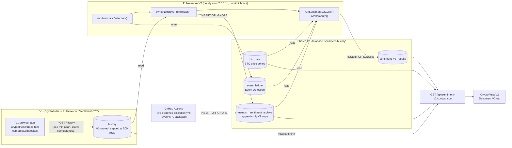

# Sentiment V2: Technical Architecture & Methodology Report

| | |
|---|---|
| Status | Describes production as deployed on 2026-11-14 |
| Backend | `quiquandon-oss/PulseWorkerV2` `main` at merge commit `20dba39` (Worker version `6b1ed97a-09dc-40d2-9b7e-7b2f27dd3d98`) |
| Frontend | `quiquandon-oss/CryptoPulseV2` `main` at merge commit `084a772` |
| V2 calc version | `sv2-1.0.0` |
| Spec | [`docs/SENTIMENT_V2_BUILD_SPEC.md`](SENTIMENT_V2_BUILD_SPEC.md); design record: PulseWorkerV2 `docs/SENTIMENT_V2_IMPLEMENTATION.md` |

**Sources for every statement here**
- Production source code at the commits above.
- The D1 schema migrations.
- The production API.
- A replay of the first production result through the unchanged production functions (§4).

Line numbers refer to `PulseWorkerV2/worker.js` at `20dba39`; function names are the stable reference.

**Labels used in this report**
- **Implemented**: in production code and running.
- **Implemented, disabled**: in code but switched off by configuration.
- **Research only**: runs outside the Worker and never feeds the score.
- **Proposed**: not implemented.
- **Unknown**: cannot be established from code or data.

---

## 1. Architecture

### 1.1 End-to-end flow



### 1.2 What V1 produces

V1's composite is computed **in the browser** by `computeComposite()` (CryptoPulse `index.html`).

**Formula (`v1-composite-1`)**

`score = round( Σ value_s × w_s / Σ w_s )`, where `w_s = base_weight_s × confidence_s` (× 1.5 for a source named as a driver by the Foufi digest), summed over the sources that answered.

- Default weights: `SENTIMENT_DEFAULT_WEIGHTS` in PulseWorker `worker.js`. A browser may override them locally.
- A reading below 50% source completeness is not saved.
- Readings are written at most every 15 minutes, and **only while a browser has V1 open**.
- Over 30 days to 2026-11-14 this gave 207 readings, 4–8 per day, with 45 gaps longer than 4.8 h.
- **What is stored:** `history.ts`, `history.score` (integer 0–100) and `history.sources_json` (each source's 0–100 reading), plus `technical_score` and `gold_regime`.
- **Retention:** PulseWorker trims `history` to the newest 500 rows after every write.

A server-side V1 collector exists in PulseWorker (`runServerComposite`, `SERVER_COMPOSITE.md`). It is **implemented, disabled** (`SERVER_COMPOSITE` unset) and writes its own tables, never `history`.

### 1.3 Why V2 depends on V1

V2 takes **V1's per-source readings** (`sources_json`) as its evidence. It does not fetch market sentiment sources itself: the V2 code contains no `fetch` call, and a test checks this. Each V2 decision is made **at a V1 observation timestamp**, so V1, V2 and BTC can be compared at identical instants (spec §6).

What V2 does differently is in *how* it combines that evidence (§2), and in two inputs V1 does not use:
- the event ledger;
- the point-in-time BTC price history.

### 1.4 Independent vs shared components

| Component | Owner | Shared? |
|---|---|---|
| V1 composite and `history` | CryptoPulse / PulseWorker | V2 reads only |
| `btc_data` (BTC price series) | written by PulseWorkerV2 (`/btc-backfill*` routes and the tick) | shared read |
| `event_ledger` (Event Detection) | PulseWorkerV2 | V2 reads only |
| `research_sentiment_archive` | PulseWorkerV2 (Worker sync and GitHub job) | V2 input |
| `sentiment_v2_results` and V2 logic | PulseWorkerV2 | V2 only |
| D1 database `sentiment-history` | Cloudflare account | **shared by V1 and V2 Workers** |

### 1.5 Cadence and triggers

| Stage | Trigger | Frequency |
|---|---|---|
| V1 reading → `history` | browser with V1 open | irregular, ≥ 15 min apart |
| Event Detection | PulseWorkerV2 cron `0 * * * *`, non-tick hours | 16 per day (hours not divisible by 3) |
| `history` → archive (Worker) | same invocation, after detection | 16 per day; implemented 2026-11-14 (PR #133) |
| `history` → archive (GitHub backstop) | `live-evidence-collection.yml` `0 */6 * * *` | nominally 4 per day; observed about 3 per day, 0.5–5 h late |
| V2 calculation | same invocation, after the sync | 16 per day |
| API | on request, cached 5 min per period | — |
| Dashboard | on tab entry (refetch after 5 min) and the refresh button | — |

**What triggers a new V2 calculation.** A V2 run computes when the archive holds V1 observations newer than the last V2 result for `sv2-1.0.0`.
- **First run:** only the newest one.
- **Later runs:** the **newest three** newer than the last result (`maxCatchUp: 3`; query `ORDER BY observation_ts DESC LIMIT 3` in `runSentimentV2Cycle`, l. 12611).

**Consequence (observed 2026-11-14 20:00):** when more than three readings arrive between runs, the older ones are **never** computed. The 16:32 and 16:53 readings were skipped this way. See §7.

---

## 2. V2 calculation methodology (implemented, `sv2Compute`, l. 12370)

All parameters come from `sv2Config()` (l. 12039). Only data available at the decision time *t* is used:
- archive rows with `observation_ts ≤ t` (31-day window);
- `btc_data` prices at or before each timestamp;
- events with `detected_ts ≤ t`.

### 2.1 Inputs

| Input | Source | Function |
|---|---|---|
| Source readings `x_s ∈ [0,100]` | `research_sentiment_archive.sources_json`; non-numeric or out-of-range values are dropped | `sv2ParseSources` l. 12072 |
| BTC price at each observation | last `btc_data` price ≤ ts within 3 h; otherwise none | `sv2AttachPrices` l. 12093, `sv2PriceAt` l. 12117 |
| Events | `event_ledger`, detected within 72 h before *t*, not expired, asset BTC or market-wide | `sv2Events` l. 12250 |

### 2.2 Source state: fresh / stale / missing (`sv2SourceStatus`, l. 12133)

The set of **known** sources is every key seen in the window up to *t*.

| State | Rule |
|---|---|
| **missing** | known, but absent at *t* |
| **stale** | present, with the same value for ≥ 10 consecutive appearances (`staleAfterUnchanged`; the EXP-005 rule) |
| **fresh** | everything else |

Stale and missing sources are **excluded**. They are never imputed as 50.

### 2.3 Families and redundancy (`sv2Families` l. 12194, `sv2Redundancy` l. 12166)

**Nine families** (`sv2Config().families`):

| Family | Sources |
|---|---|
| market_sentiment_news | fng, cryptonews, foufi |
| derivatives_positioning | funding, longshort, hypefunding, hloi |
| institutional_flows_etf | etfflows, sosovalue |
| onchain_activity | onchain |
| macroeconomic | macrogeo, yield10y, usd, oil, gold |
| cross_asset_equities | nasdaq, sp500, ninemag |
| market_structure_breadth | global |
| regulation_geopolitics | regulatory, geopolitics |
| corporate_treasury_catalysts | strc |

`riskregime` is not mapped (unmapped).

**Redundancy.** Pearson *r* is computed over the last ≤ 120 observations where both sources are present, and only when there are at least 30 such pairs.
- Pairs with *r* ≥ 0.9 **in the same family** are merged into one group (union-find).
- Pairs across families are reported but not merged.

**Family score:**

```
family_score_f = mean over independent groups g in f of ( mean of fresh x_s in g )
```

It is null when the family has no fresh source.

### 2.4 Composite and final score (`sv2Compute`)

```
composite   = mean of family_score_f over families with a score        (equal family weights, hypothesis H1)
adjustment  = round2( 10 × event_intensity × direction_balance )        (§2.6)
score       = clamp(composite + adjustment, 0, 100), rounded to 2 decimals
```

`sentiment_class` (`sv2Classify` l. 12361):

| Score | Class |
|---|---|
| < 25 | strongly_bearish |
| < 45 | bearish |
| ≤ 55 | neutral |
| ≤ 75 | bullish |
| above 75 | strongly_bullish |

### 2.5 Evidence coverage and confidence

```
evidence_coverage = (# fresh known sources) / (# known sources)                      [0,1]
agreement         = max(0, 1 − sd(family scores) / 25)     (sample sd; 0 if one family)
confidence        = round3( min(1, 0.6 × evidence_coverage + 0.4 × agreement) )      (hypothesis H8)
```

The confidence weights 0.6 / 0.4 and the divisor 25 are design choices. They are **not calibrated** against outcomes.

### 2.6 Events (`sv2Events` l. 12250)

**1. Grouping.** Relevant events are grouped by `correlation_key`, then `dedup_key`, then `event_id`. The representative event is the most severe, earliest first.

**2. Per-group values:**
- `direction`: the shared direction, or `MIXED`, which counts as 0.
- `novelty = exp(−ln2 × (t − first_detected) / 24 h)`.
- `weight = severity_w × novelty × confidence`, with severity_w LOW 0.25, MEDIUM 0.5, HIGH 0.75, CRITICAL 1.
- `family`: assigned by keyword rules on type and rule (`sv2EventFamily` l. 12213).
- `role`, based on the 6-hour BTC move before first detection:
  - **consequence**: the event family is market structure (price-derived), or the move is ≥ 2% in the event's direction;
  - **coincident**: the move is ≥ 1%;
  - **cause_candidate**: otherwise.
  - `role` is **reported only**; it does not change the weight.
- `overlap`: if the event's family already has a fresh score, its directional effect is halved (factor 0.5, H6).

**3. Aggregates:**

```
event_intensity   = 1 − Π (1 − min(1, weight_g))                         [0,1]
direction_balance = Σ dir_g × weight_g × overlap_g / Σ weight_g           [−1,1]
adjustment        = round2(10 × event_intensity × direction_balance)     [−10,+10]   (H7)
```

**4. Reaction priors** (`sv2EventReactions` l. 12227): the mean 24-hour BTC return after earlier detections of the same type, using only outcomes observable at *t*. Stored as `reaction_prior`. **Not used in the score.**

### 2.7 Market regime (`sv2Regime` l. 12301)

Inputs are point-in-time BTC returns over 24 h, 7 d and 30 d, plus realised volatility (hourly-normalised log returns × √24) over 7 d and 30 d. Rules are applied in order:

1. `insufficient_history`: no price at *t*, or no 7-day price.
2. `stress_high_volatility`: vol7 > 1.5 × vol30, or |ret24| ≥ 5%.
3. `bullish`: ret30 (else ret7) ≥ +5% and ret7 ≥ 0.
4. `bearish`: ret30 (else ret7) ≤ −5% and ret7 ≤ 0.
5. `sideways`: otherwise.

The regime is **reported**, not used in the score. An HMM is a research challenger only (H5).

### 2.8 Predictive signal (`sv2Analogues` l. 12337), kept apart from sentiment

- Find the 20 earlier observations whose family profile is closest (RMS distance over at least 5 common families) and whose 24-hour outcome was already observable at *t*.
- `p_up` = the share of those whose BTC price rose.
- At least 10 analogues are required.
- Stored in `predictive_json` with `validation: candidate_unvalidated`. **Not part of the sentiment score.**

### 2.9 Status, errors and fallbacks

| Situation | Behaviour |
|---|---|
| No family has a fresh source | `status FAILED`, `sentiment_score NULL`, confidence 0 |
| Coverage < 0.5 | `DEGRADED` / `low_evidence_coverage` |
| `event_ledger` unreadable | events empty; `DEGRADED` / `event_ledger_unavailable` |
| Price or event read cap reached | `DEGRADED` / `inputs_truncated` |
| AI enabled and its call errors or returns invalid output | `DEGRADED` / `ai_<status>`; **the score is unchanged** |
| Results table missing | the cycle skips (`migration 0027 not applied`) and writes nothing |
| Retried run | `INSERT OR IGNORE` on `UNIQUE(asset, calc_version, decision_ts)`, so nothing is duplicated |
| Archive sync fails | logged as `v1 archive sync (cron) FAILED`; V2 still runs on what the archive holds |

---

## 3. Database and data lineage

| Table | Purpose | Key fields | Written by | Write frequency |
|---|---|---|---|---|
| `history` | V1 readings | `ts`, `score`, `sources_json`, `technical_score`, `gold_regime` | V1 browser via PulseWorker `POST /history` | irregular; trimmed to 500 rows |
| `research_sentiment_archive` (migration 0015) | permanent, append-only copy of V1 readings; V2's only V1 input | `observation_ts` (UNIQUE), `sources_json`, `score`, `technical_score`, `btc_price` (always NULL), `gold_regime`, `source_weights_version` `v1-unversioned`, `schema_version` `exp5-v1`, `written_by`, `content_hash`, `archived_ts` | Worker `syncV1ArchiveFromHistory` (`pulseworker-v2-archive-sync`) and the GitHub job (`experiment5-pipeline`) | hourly (non-tick) and every 6 h |
| `btc_data` | BTC price series | `ts`, `btc_price` | PulseWorkerV2 | several per hour |
| `event_ledger` | detected market events | `event_id`, `dedup_key`, `correlation_key`, `event_type`, `asset`, `detected_ts`, `direction`, `severity`, `confidence`, `rule_id`, `expires_ts` | PulseWorkerV2 Event Detection | hourly (non-tick) |
| `sentiment_v2_results` (migration 0027) | V2 outputs | see below | `runSentimentV2Cycle` | 0–3 rows per non-tick hour |
| `sentiment_v2_ai_calls` (migration 0027) | atomic daily AI-call ceiling | `day`, `slot` | `sv2RunAi` reservation | 0 (AI disabled) |
| `d1_usage_daily` | per-route and per-cron D1 usage | — | Worker wrapper | each invocation |

**`sentiment_v2_results` columns:**
- `status` (OK, DEGRADED or FAILED) and `degraded_reason`;
- `sentiment_score` 0–100, `sentiment_class`, `confidence` 0–1, `evidence_coverage` 0–1;
- `market_regime` with `regime_json`;
- `event_intensity` with `event_json`;
- `predictive_json`;
- `family_json` (family scores, contributions, redundancy, `composite_before_events`);
- `supporting_ids_json` and `contradicting_ids_json`;
- `missing_json`;
- `ai_model`, `ai_status`, `ai_json`;
- `usage_json` and `created_ts`.

The table has CHECK constraints on the ranges and `UNIQUE(asset, calc_version, decision_ts)`.

**Content hash.** `content_hash = sha256` of the newline-joined:
- `observation_ts`, `sources_json` text;
- the JSON forms of `score`, `technical_score`, `btc_price` and `gold_regime`;
- `source_weights_version` and `schema_version`.

It is computed by `research/sentiment_archive.py::compute_content_hash` and, byte-identically, by `v1ArchiveContentHash` (l. 12550; tested against golden hashes from the Python module).

- `UNIQUE(observation_ts)` with `INSERT OR IGNORE` prevents duplicates when both writers race.
- The Python module raises `ArchiveConflictError` on the same timestamp with a different hash, so a reading is never silently overwritten.
- No writer issues UPDATE or DELETE.

**Traced reading: V1 2026-11-14 18:30:43.592 UTC (`ts` 1794681043592)**

| Step | Evidence |
|---|---|
| 1. V1 writes `history` | `/db-check` at 19:43 UTC: `max_ts` 1794681043592 |
| 2. Not yet archived at 19:43 | comparison API: newest archived V1 was 11:23:37 |
| 3. Copied by the Worker in the 20:00 UTC run | `/api/research-lab/experiment5-sentiment`: row `observation_ts` 1794681043592, score 41, technical_score 51, 22 sources, present at 20:01:11 |
| 4. V2 computed in the same run | comparison API: `ts` 1794681043592, `v1` 41, **`v2` 39.54, `v2_status` OK**, BTC 66,029 (btc_data ts 1794679257183) |

`written_by` and `content_hash` are not exposed by any public route. Reading them needs a read-only D1 query:

```
wrangler d1 execute sentiment-history --remote --command "SELECT observation_ts, written_by, content_hash FROM research_sentiment_archive WHERE observation_ts = 1794681043592"
```

---

## 4. First production result, explained (decision `ts` 1794655417334 = 2026-11-14 11:23:37 UTC)

**Method.** I fed the production inputs (all four kinds below) through the **unchanged production functions** extracted from `worker.js` (`sv2Config` … `sv2Compute`):
- the archive rows from `/api/research-lab/experiment5-sentiment` (221 rows, 31-day window);
- all 109 events from `/api/events` in that window (103 detected before *t*);
- `btc_data` from `data-exports/btc_data.csv` (489 prices in the window).

**The replay reproduces every stored value exactly:** score 24.01, class strongly_bearish, confidence 0.667, coverage 0.826, regime bearish, event intensity 0.746. The intermediate values below are therefore what production computed, not estimates.

### 4.1 Source states (23 known sources)

- **Fresh (19):**

| Source | Reading | Source | Reading | Source | Reading |
|---|---|---|---|---|---|
| fng | 13 | cryptonews | 66 | funding | 44 |
| longshort | 41 | hypefunding | 32 | hloi | 37.99 |
| etfflows | 2 | sosovalue | 26 | onchain | 6 |
| macrogeo | 50 | yield10y | 2 | usd | 40 |
| oil | 53 | gold | 43 | nasdaq | 29 |
| sp500 | 40 | ninemag | 35 | regulatory | 23 |
| geopolitics | 6 | | | | |

- **Stale (2):** foufi 25 and strc 50, each unchanged for 10 observations.
- **Missing (2):** global and riskregime (riskregime is also unmapped).

**Coverage = 19 / 23 = 0.826.** No source pair reached r ≥ 0.9, so every fresh source is its own group.

### 4.2 Family scores

| Family | Fresh sources | Score | Contribution vs 50 |
|---|---|---|---|
| market_sentiment_news | fng 13, cryptonews 66 (foufi stale) | 39.50 | −1.50 |
| derivatives_positioning | funding 44, longshort 41, hypefunding 32, hloi 37.99 | 38.75 | −1.61 |
| institutional_flows_etf | etfflows 2, sosovalue 26 | 14.00 | −5.14 |
| onchain_activity | onchain 6 | 6.00 | −6.29 |
| macroeconomic | macrogeo 50, yield10y 2, usd 40, oil 53, gold 43 | 37.60 | −1.77 |
| cross_asset_equities | nasdaq 29, sp500 40, ninemag 35 | 34.67 | −2.19 |
| regulation_geopolitics | regulatory 23, geopolitics 6 | 14.50 | −5.07 |
| market_structure_breadth | global missing | — | 0 |
| corporate_treasury_catalysts | strc stale | — | 0 |

**Composite** = (39.50 + 38.75 + 14.00 + 6.00 + 37.60 + 34.67 + 14.50) / 7 = **26.43**.

### 4.3 Events

- 12 events in the 72-hour window had expired; 0 were for other assets.
- Three groups remained, all LIQUIDATION_BURST, all classified as derivatives_positioning, all `cause_candidate`.

| Severity | Direction | Novelty | Weight | Overlap with a fresh family |
|---|---|---|---|---|
| CRITICAL | MIXED | 0.588 | 0.388 | yes |
| HIGH | DOWN (3 detections) | 0.741 | 0.366 | yes |
| HIGH | DOWN | 0.699 | 0.346 | yes |

```
intensity  = 1 − (1−0.388)(1−0.366)(1−0.346) = 0.746
balance    = 0.5 × (0×0.388 − 0.366 − 0.346) / (0.388+0.366+0.346) = −0.324
adjustment = round2(10 × 0.746 × −0.324) = −2.42
score      = 26.43 − 2.42 = 24.01   → strongly_bearish (< 25)
```

### 4.4 Confidence

- sd of the 7 family scores = 14.31.
- agreement = 1 − 14.31 / 25 = 0.427.
- confidence = 0.6 × 0.826 + 0.4 × 0.427 = **0.667**.

### 4.5 Regime

| Measure | Value |
|---|---|
| ret24 | −2.51% |
| ret7d | −12.10% |
| ret30d | −17.64% |
| vol7 | 0.0309 |
| vol30 | 0.0212 |

- Not stress: vol7 0.0309 < 1.5 × vol30 (0.0317), and |ret24| < 5%.
- ret30 ≤ −5% and ret7 ≤ 0, so **bearish**.

### 4.6 Predictive signal (not in the score)

20 analogues, `p_up` 0.30, mean distance 11.15, `candidate_unvalidated`.

### 4.7 Why 24.01 and not 30

V1's stored 30 **cannot be reproduced exactly from the archive.** The same 21 readings with the default weights give 31.15, which rounds to 31. The browser's per-device weight overrides and the Foufi driver boost are not archived. The ~7-point gap has three verified causes:

**1. Equal family weighting** (largest effect).

| Family | Share in V1 (default weights) | Share in V2 |
|---|---|---|
| onchain_activity (6) | 3.3% | 14.3% |
| market_sentiment_news, incl. cryptonews 66 | 22.4% | 14.3% |
| regulation_geopolitics (14.5) | 11.0% | 14.3% |

V2's equal-family composite (26.43) is about 4.7 points below the default-weight V1 value.

**2. Stale sources excluded.** strc (50) and foufi (25) count in V1 but not in V2. Removing strc's neutral 50 lowers the score.

**3. Event adjustment of −2.42** from the recent liquidation bursts. V1 has no event term.

---

## 5. AI integration

- **Status: implemented, disabled.** `sv2RunAi` (l. 12467) calls only the account's Workers AI binding, and only when both conditions hold:
  - `SENTIMENT_V2_AI_MODEL` is set (currently `""`);
  - `SENTIMENT_V2_AI_DAILY_CALLS` > 0 (currently `"0"`).
- Every result records `ai_status: disabled`.
- **Why it is off:** spec §3 (zero paid cost). The account's model catalogue, licence and free quota have not been verified, because no Cloudflare credential was available when the code was built.
- **What it would do:** annotate only. The output must pass `sv2ValidateAiOutput` (l. 12442):
  - only the keys `summary`, `cited_ids`, `contradictions`, `event_relevance` and `uncertainty`;
  - cited ids must exist in the evidence package;
  - any extra field, such as a score, is rejected.
- **AI cannot change any number.** An AI failure only marks the row DEGRADED.
- **Deterministic today:** everything in §2.
- **Research only (outside the Worker):** TimesFM (EXP-004) and Chronos (EXP-008) GitHub Actions experiments. None feeds V2.
- **Proposed only:** TiRex, LightGBM/XGBoost and an HMM regime model.

---

## 6. V1 vs V2

| Dimension | V1 (verified) | V2 (verified) |
|---|---|---|
| Methodology | weighted mean of source readings, `w = base × confidence` (× 1.5 Foufi boost), renormalised over answering sources, rounded to an integer | equal-weight mean of family scores, plus a bounded event adjustment (±10), 2 decimals |
| Inputs | 22–23 live sources fetched by the browser | V1's archived per-source readings, `btc_data`, `event_ledger` |
| Evidence handling | failed sources are excluded; a reading needs ≥ 50% completeness | fresh / stale / missing per source; stale and missing are excluded; redundancy grouping; coverage is reported |
| Confidence | per-source confidence is a weight factor; there is no output confidence | output `confidence` = 0.6 × coverage + 0.4 × family agreement (uncalibrated) |
| Event analysis | none in the composite | dedup, novelty decay, severity × confidence weight, overlap halving, role labelling, intensity, adjustment |
| Market regime | not part of the composite | rule-based regime (reported, not scored) |
| AI | none in the composite | annotation only; implemented, disabled |
| Historical storage | `history`, last 500 rows only | archive (append-only) and `sentiment_v2_results` (one row per V1 timestamp, no backfill) |
| Update mechanism | browser open, ≥ 15 min apart | hourly non-tick cron, newest ≤ 3 pending V1 readings per run |

**What V2 adds:**
- stale-source exclusion;
- family balancing;
- event intensity;
- an explicit confidence, coverage and missing-evidence record;
- a separated predictive candidate;
- full provenance per result.

**What V2 does not do:**
- produce readings without V1;
- weight families by demonstrated predictive value;
- use AI;
- backfill history;
- compute skipped readings.

---

## 7. Limitations and future development

| Area | Limitation |
|---|---|
| Dependency | V2's cadence equals V1's, and V1 only produces readings while a browser has V1 open (4–8 per day, gaps up to about 19 h). |
| Catch-up | At most 3 pending readings per run, newest first. Older ones are skipped permanently (16:32 and 16:53 on 2026-11-14). Changing this is a V2 methodology decision for the owner. |
| Latency | A reading reaches V2 at the next non-tick hour: up to about 2 h after the fix, previously up to about 12 h. |
| Data quality | Source freshness is inferred from unchanged values, since V1 readings carry no per-source timestamps. `market_structure_breadth` has no live source. `riskregime` is unmapped. |
| Historical | No V2 history before 2026-11-14 11:23 UTC (by design: no reconstructed backtests). The archive holds only what was copied before `history` trimmed it. |
| False confidence | `confidence` measures coverage and agreement, **not** accuracy. A high-confidence wrong call is possible. The H1–H8 constants are unvalidated. |
| Observability | Worker logs and `content_hash` are not readable through public routes. |

**An independent V2 trigger (proposed, not implemented).** Driving V2 from the existing hourly cron, with server-side source collection, would remove the browser dependency and give a regular, auditable cadence. PulseWorker's `runServerComposite` (scomp-v1) already collects about 78% of base weight server-side. It is switched off and writes separate tables.

Risks of switching:
- a change of input (server readings differ from browser readings);
- a loss of V1/V2 timestamp alignment unless V1 also moves server-side.

**Recommendation:** first collect at least 2 weeks of scomp-v1 data in parallel, and compare it with the browser readings at matching timestamps.

---

## 8. Validating whether V2 is better than V1

**No claim of superiority is possible yet.** On 2026-11-14 V2 had 4 results.

**Evaluation protocol.** Prospective only, on aligned timestamps, with both series frozen at decision time.

| Criterion | Metric | Baseline |
|---|---|---|
| Directional accuracy | hit rate of (score > 50) vs the sign of the next 24 h BTC return; Brier score of a monotone mapping fitted out of sample | V1; always-majority; previous-24h-return sign |
| Early detection | lead or lag (hours) between a score crossing 45 or 55 and a subsequent ≥ 3% BTC move | V1 |
| Response to major events | score change within 6 h after HIGH/CRITICAL events vs realised move; false-alarm rate | V1 |
| Stability | score volatility per regime; flip rate without a price move | V1 |
| Confidence calibration | accuracy by confidence decile; reliability curve | — |
| Regime breakdown | each metric per `market_regime` | — |
| Out of sample | walk-forward; no parameter changes during the evaluation window | — |
| Significance | paired test (McNemar for hit rate, Diebold-Mariano for loss) | — |

**Minimum sample:**
- **Before any decision:** ≥ 100 aligned decisions with resolved 24-hour outcomes. At the current cadence that is about 3–4 weeks.
- **Before declaring V2 better:** ≥ 30 decisions per regime.

---

## 9. References

| Item | Location |
|---|---|
| V2 logic | PulseWorkerV2 `worker.js` l. 12024–12700 (`sv2*`, `runSentimentV2Cycle`) |
| Archive sync | PulseWorkerV2 `worker.js` l. 12514–12609 (`syncV1ArchiveFromHistory`) |
| Cron wiring | PulseWorkerV2 `worker.js` l. 11611 (`scheduled`, `0 * * * *`) |
| API | PulseWorkerV2 `worker.js` l. 10873 (route), l. 12730 (`getSentimentV2Comparison`) |
| Schemas | PulseWorkerV2 `.ai/migrations/0015_experiment5_sentiment_archive.sql`, `0027_sentiment_v2_results.sql` |
| Python archive | PulseWorkerV2 `research/sentiment_archive.py`, `research/experiment5_pipeline.py` |
| Tests | PulseWorkerV2 `tests/sentiment-v2.test.js`, `tests/v1-archive-sync.test.js`; CryptoPulseV2 `tests/view-models.test.mjs` |
| V1 composite | CryptoPulse `index.html` `computeComposite`; PulseWorker `worker.js` `SENTIMENT_DEFAULT_WEIGHTS`, `SERVER_COMPOSITE.md` |
| Frontend | CryptoPulseV2 `index.html` (`sentimentV2Model`, `renderSentimentV2`) |
